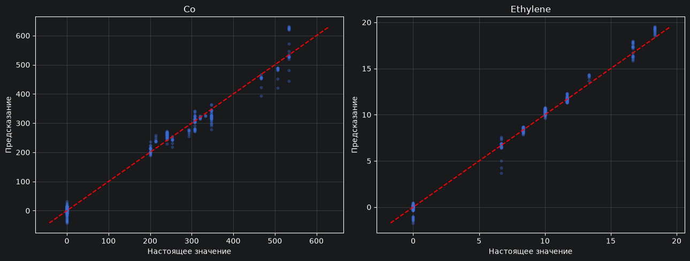

# Model 1 - Pooling + CNN + AvgPooling
## Parameters:

    class BaselineLSTM(nn.Module):
        def __init__(self, channels):
            super().__init__()
    
            self.channels = channels
    
            self.pooling = nn.AvgPool1d(kernel_size=5, stride=5)
    
            self.cnn = nn.Sequential(
                nn.Conv1d(self.channels, 32, 7, padding=3),
                nn.ReLU(),
                nn.Conv1d(32, 64, 5, stride=2, padding=2),
                nn.ReLU(),
                nn.Conv1d(64, 128, 5, stride=2, padding=2),
                nn.ReLU(),
                nn.Conv1d(128, 128, 5, stride=2, padding=2),
                nn.ReLU(),
                nn.Conv1d(128, 256, 5, stride=2, padding=2),
                nn.ReLU(),
                nn.Conv1d(256, 32, 5, stride=2, padding=2),
                nn.ReLU(),
                nn.Conv1d(32, 2, 3, padding=1),
                nn.AdaptiveAvgPool1d(1),
            )
    
        def forward(self, x):
            x = self.pooling(x)
            x = self.cnn(x).squeeze(-1)
            pred = x
            return pred

## Graph

## Test results:
### Window slicing
- Normalized MSE: **0.00920**
- Co: MAE=**11.511**, RMSE=**18.292**
- Ethylene: MAE=**0.232**, RMSE=**0.382**

CO
  - MAE при target = 0: 6.6221347
  - MAE при target > 0: 20.926481

Ethylene
  - MAE при target = 0: 0.13331757
  - MAE при target > 0: 0.36768523
### 

# Model 2 - Pooling + CNN + LSTM + MLP
## Parameters

## Graph

## Test results
### Window slicing
- Normalized MSE: 0.00210
- Co: MAE=3.977, RMSE=7.808
- Ethylene: MAE=0.122, RMSE=0.226

CO
- MAE при target = 0: 0.37517327
- MAE при target > 0: 10.914254

Ethylene
- MAE при target = 0: 0.01853863
- MAE при target > 0: 0.26378778
